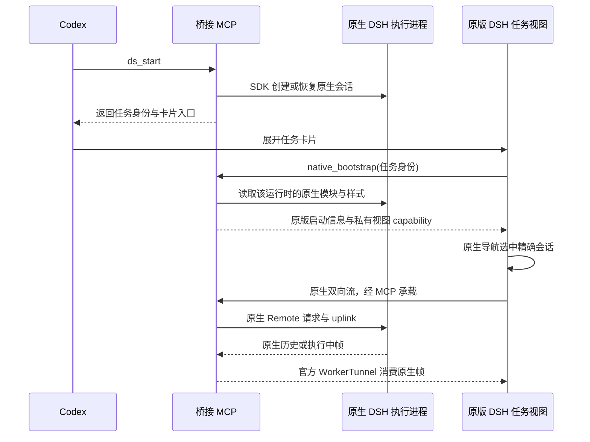

# 原生 DSH 复用实现：当日收尾

日期：2026-10-24，Asia/Shanghai。用户要求结束今天工作；不再启动新实验或请求新的目视复验。

## 产品要求更正，后续以此为准

**流内展示应隐藏或禁用 DSH 自身的侧边抽屉功能；在 Codex 侧边展开时保留相应完整功能。**

这是用户希望实现的模式差异，不是“已经发现流内缺少抽屉”的故障描述，也不是已经完成的实现。应使用 DSH 原生布局/slots 接缝控制；不能重写会话界面，也不能连带删除执行环境中的工具和插件能力。Codex 的“侧边查看”入口仍保留。

用户另确认：侧边关闭后流内应保持收起，避免自动展开撑动对话；主动流内展开时应有可阅读的高度。

## 已交付与实际证据

- 官方 `WorkerTunnel` 原样收录、构建接入，保留 MIT 许可、固定版本与文件哈希；MCP 适配只转换载体帧。来源见 `THIRD-PARTY-NOTICES.md`。
- 正式桥增加 **`CODEX_DSH_UI=mcp`** 可选路径，默认仍保留旧路径；本轮没有给主实例改配置或重载 MCP。新视图使用公开 npm 包 `@deepseek-ai/dsh-client-web@0.2.1-rc.2` 的 `AppWebEntry`，组件、插件批次及样式来自实际 DSH 运行时。
- 精确会话导航借鉴 DSH-for-Vscode 的 MIT 发布版客户端：等原生工作区/会话基线就绪后调用 `uiWorkspace.openSession(target)`，不创建替代会话。模块清单与 initial-load batch 一并注册。
- 真实第二实例首次失败：漏了加载批次，原生校验器报 `belongs to no initial-load batch`。修复并增加安装包内真实解析器的正反断言；同时修复慢启动被 5 秒状态刷新重复重启、同一静态错误反复重试。
- **用户目视确认**：展开后无需再点历史列表，自动出现目标历史正文；主体“大部分正常”。用户仍报告偶发抽动，以及 Codex 工作完成后流内高度太矮。不能标注布局已通过。
- 独立零模型真实联调：A、B 两个运行时各读取 48 条历史；关闭 A 的流后 B 仍可用；关闭 view capability 后请求被拒绝；`session/prompt` 被拒绝。后续 B fixture 增加独立会话与正文标记，B home 同时保留 A、B 两条相同 cwd 的历史，协议检查通过。**新增 B 标记尚未宿主目视复验**。
- 最终离线测试 **81/81**，无跳过。不是新增真实模型调用数；**本轮真实模型调用为 0**。

## 已保存但尚未目视复测的布局改动

资源更新为 `ui://dsh-native/task-v3.html`。侧边打开前折叠流内源视图，返回流内仍保留一行入口；显式展开时请求 600px；共享每任务折叠状态以兼容宿主创建新视图。高度被宿主缩小时仅做有界修复，避免无限尺寸协商。

这部分仅通过离线测试，**用户今天实际看过的是 v2，不是 v3**。按用户收尾要求，未再次重启第二实例验证。也尚未实现上节要求的“流内隐藏原生 DSH 抽屉”。

## 执行时序与所有权

参考 [CodexHost 架构图](https://github.com/BytePioneer-AI/codex-host/blob/82e4839808ae692ac5cd0c23339c3db8e7a043c9/docs/imgs/pi-runtime-architecture.png) 的执行/会话所有权划分；未复制其当前 LGPL 源码或图像资产。以下为本项目自己的调用时序：

模型循环、上下文、压缩、工具与原生子 agent 由 DSH 所有；卡片不使用 transcript 重建这些能力。以上是实现时序，不代表每项真实交互均已验收。

## 下一次从这里继续

1. 先复验 v3 的高度和关闭行为；再通过官方布局/slots 实现并验收流内禁用抽屉、侧边完整展示。
2. 在 Codex 中切换带 B 正文标记的新 fixture；确认目标是 B，且 A/B 不串。现有自动正文确认不能替代这项更强验证。
3. 用最小必要实验验证执行结束前正文多次增长。此前旧通道的 592 个瞬态片段与本轮历史可见，不能合并推导新载体的真实流已通过。
4. 再验证真实原生子 agent、审批/提问、停止/续接/压缩；核实并接入对应版本 OPS 与侧边余额插件。旧 `deepseek_worker` 继续保留；统一 adapter 尚未完成。

## 恢复入口与隔离边界

- 正式代码：`src/native-task-ui.mjs`、`src/native-web-peer.mjs`、`ui/native-task.mjs`。
- 显式零模型入口：`scripts/native-task-ui-probe.mjs`；真实传输检查：`scripts/check-native-task-ui.mjs`。普通 `npm test` 不启动这些服务。
- 第二实例登记名：`dsh_native_task_probe`；展示端口 19071/19072，独立检查 19081/19082。
- 私有证据：`.local/codex-dev-instance-20261024/native-task-probe/report.json` 与 `native-task-check/live-check.json`。不提交 token、cookie、凭据或用户 profile。
- 临时实验配置和取样仓库保留在忽略的 `.local/`，供下次复现；不做无关清理，不删除 worker 安装或主环境。第二实例在收尾时关闭，今天不再开启。
- 所有提交按功能分支、原子提交和 `--no-ff` 合并收敛；只做本地提交，未推送。
